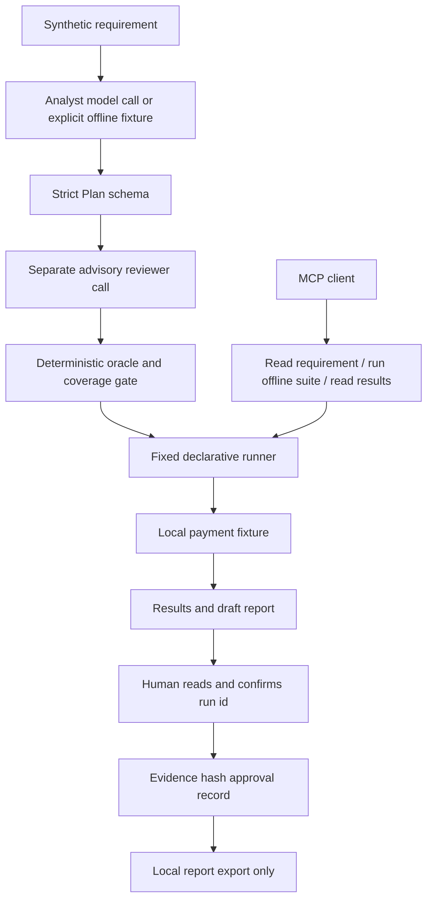

# Reviewed agentic QA workflow

A runnable demonstration of AI-assisted requirement analysis and declarative test generation, a separate model review, deterministic assertion checks, fixture execution and a human report-approval step. Includes a real MCP stdio server and client smoke test.

This is a bounded, staged workflow, not an autonomous coding agent. It generates structured test scenarios rather than executing arbitrary model-written Python. The separate reviewer uses a fresh model conversation, not a different underlying model. Deterministic checks enforce a known contract; they do not solve general test-oracle correctness.

## Quick start without a model

```bash
python3.12 -m venv .venv
source .venv/bin/activate
pip install -r requirements.lock
pip install -e . --no-deps
pytest -q --junitxml=reports/junit.xml
qa-demo run --mode offline
python scripts/mcp_smoke.py
```

Python 3.12 is the verified environment. Windows activation: `.venv\Scripts\activate`.

Offline mode loads a **hand-authored simulated model response**, not a recording of a live model. It deliberately proposes one incorrect expectation: accepting a zero payment. The review gate rejects that suggestion and runs the remaining scenarios. It neither silently calls a model nor claims AI work occurred.

## Live local model

Install and start Ollama, then make a model available:

```bash
ollama pull qwen3:4b
qa-demo run --mode ollama --model qwen3:4b
```

The default endpoint is http://127.0.0.1:11434; override it with `--base-url`. Two separate structured-output calls generate and review the plan. Pydantic validates both responses. Missing coverage or malformed output stops the workflow and writes an error record. Live responses can differ even at temperature zero; a failure is evidence to inspect, not something the runner conceals. No automatic retry or fabricated success is implemented.

The checked-in live example, when present under `docs/evidence/live`, comes from a real local model run and records its model and mode. It is a draft for human review.

## Demonstrate a defect

```bash
qa-demo run --mode offline --seeded-bug
```

This intentionally exits 1: the fixture accepts zero-valued payments. The zero and mixed-batch atomicity cases should fail. Run without `--seeded-bug` to demonstrate the corrected behaviour. The unit suite verifies both outcomes.

## Architecture and boundaries



The model reviewer is advisory; its concerns remain in the draft for human review. Execution is controlled by schema, assertion and coverage checks. The model never receives shell execution tools. MCP exposes no approval or publish tool. Live model calls are orchestrated by the CLI, not by autonomous MCP tool selection.

Each run stores the requirement snapshot, model identity, generated plan, reviewer comments, deterministic review, results and draft report in `runs/<id>/`. Mandatory coverage includes minimum, maximum, zero, precision, currency, duplicate, empty and mixed-batch cases. Coverage is a small heuristic checklist, not proof of comprehensive testing.

## Human report approval

Read the run's draft, plan, review and results, then:

```bash
qa-demo approve RUN_ID --reviewer "Your name"
# Read the displayed report and type the run id to confirm.
qa-demo export RUN_ID
```

Approval is bound to a hash of all evidence files. Editing evidence invalidates export. This is a local workflow guard, **not an authentication or tamper-proof security boundary**: a person or process with filesystem access can change files and invoke approval functions. Export creates a local copy; no external issue posting is implemented. Approval means the evidence was reviewed, not that all tests passed or that software is approved for release. Tests of this mechanism use temporary synthetic approvals; checked-in examples are unapproved drafts.

## MCP connection

```json
{
  "mcpServers": {
    "qa-demo": {
      "command": "/absolute/path/to/agentic-qa-workflow-demo/.venv/bin/python",
      "args": ["-m", "qa_workflow.server"]
    }
  }
}
```

After an editable install, the module resolves its fixture paths independently of the client's working directory. The smoke script initializes an actual MCP session, discovers all three tools, reads the requirement, runs the suite and retrieves its results. `run_demo_suite` always uses the reviewed offline fixture. This demo pins the tested MCP Python SDK 1.x API; upgrading to SDK 2.x requires a compatibility check.

## Limitations and honest scope

- All requirements and payment data are synthetic. No employer systems or source code are used.
- The fixture implements validation only: no banking integration or durable ledger.
- No general Python generation, execution sandbox, browser agent, dashboard, hosted service or automatic GitHub issue creation is included.
- Model output is untrusted. Schema validation and the small executable specification constrain this demo but are not a universal defence against malicious inputs.
- The latency requirement remains an open question. The workflow does not invent a performance threshold.
- The repository demonstrates an approach related to the CV; its results are not evidence of the CV's employer savings claims.

Built with Codex assistance from Mike Smith's portfolio brief. See [walkthrough](docs/walkthrough.md) and the [automation demo](https://github.com/peripheralmike/python-quality-engineering-demo).
